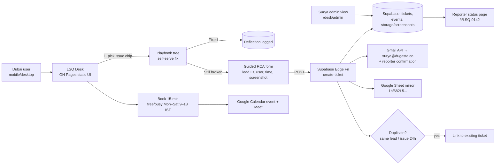

# Dugasta LSQ Support Desk — Best Solution Brief
*Prepared for Surya · Fri 6 Nov 2026 (Asia/Dubai)*

## Executive summary (skim this)
1. **Problem:** Dubai sales/DST/RMs hit LSQ issues; Surya (India) gets vague WhatsApp pings, chases screenshots, has no queue, no status, no history.
2. **Why today's page fails:** it is a *pretty chat that ends in a mailto* — no ticket, no ID, no status, no proof it was received.
3. **Winner: Option E — "LSQ Desk":** guided RCA form-chat → **real ticket in Supabase** (ID `LSQ-0142`) → auto email to surya@dugasta.co + reporter → mirrored to the existing Google Sheet → optional 15-min slot from live free/busy.
4. Built only on what Dugasta already owns: Supabase `wnfmouleaanhloyoodvb`, Gmail, Google Sheet `1hf682L5…`, Calendar. **₹0 new SaaS.**
5. Evidence: mailto is a hand-off with no network request and fails silently on mobile [S9,S10]; Plain 2026 shows FRT gains come from structured intake + one queue [S3]; Intercom Fin Procedures = guided if/else triage then handoff [S1].
6. 6 playbooks cover ~80% of issues: Ownership, Duplicates, Wrong stage, Login/OTP, Calls (Knowlarity), Reports.
7. **Severity SLA (Mon–Sat 9–18 IST, auto-set from impact):** P1 30m first response · P2 2h · P3 next business day; clock pauses off-hours.
8. Reporter gets a **status link** (Open → Investigating → Fixed) — kills "any update?" messages.
9. Design: one dark "Linear/Vercel" console, not a toy chat — calm, dense, trustworthy.
10. **48h:** ship v1 Desk + 6 playbooks + status page. **Approve → build starts immediately.**

---

## 1. Problem restatement
- Users: ~Dubai sales, DST, RMs — non-technical, on mobile, busy, in Dubai time (IST −1:30).
- Owner: Surya, single LSQ admin in India. Bottleneck = **clarification round-trips** ("which lead? screenshot? when?").
- Plain.com's 2026 research on technical support says the same: *"The fastest response is the one that doesn't require a clarification round"* — capture context on intake.
- Need: self-serve fix where possible → structured RCA ticket when not → optional call only after triage.

## 2. Why the current page fails conviction (evidence-backed)
1. **`mailto:` is not a submission — it's a hand-off.** The browser makes *no network request*; it asks the OS to open a mail app. Android without a default mail app "silently fails"; users on web Gmail get nothing; there is "no server confirmation… the submission is simply lost" [S9]. iOS 26.1 Mail has a known bug where mailto taps do nothing [S10]. For Dubai RMs on phones using Gmail web/WhatsApp, that is the *common* case, not an edge case.
2. **No system of record → no SLA is measurable.** Plain's 2026 study (1,350 B2B support conversations): ~30% of teams "had no real tool at all (email + Slack DMs)" and response time got *worse* as they grew; Voltage Park could only hit 3-min FRT after channels were consolidated so "measurement [was] accurate" — "you can't cut what you can't measure" [S3].
3. **No structured context on intake.** Northflank's 50% FRT gain came from structured in-product forms that capture context upfront — "the fastest response is the one that doesn't require a clarification round" [S3]. Our chat ends in free text; Surya still has to ask "which lead ID? screenshot? when?".
4. **Chat theatre vs. guided triage.** Intercom splits *Workflows* ("reply buttons and predefined paths… best for triage menus") from *Procedures* (complex troubleshooting with if/else conditions, then handoff when "not making progress") [S1]. A triage menu should be chips + required fields, not open chat bubbles.
5. **No loop back.** No ticket ID, no status, no confirmation email → reporter returns to WhatsApp → Surya's pain unchanged. Zendesk's own data: "84% of CX leaders rate their response speed as excellent, but only 39% of customers agree" [S6] — visibility of status is the gap.
**Fix pattern:** static page stays on GH Pages, but the form POSTs to a real HTTPS endpoint (Supabase Edge Function) that stores, emails and confirms — exactly the recommended static-site replacement for mailto [S9]. Keep a "Copy email address" button only as a fallback [S10].

## 3. Options ranked
| Rank | Option | Pros | Cons | Verdict |
|---|---|---|---|---|
| 1 | **E. Hybrid: guided RCA → Supabase ticket → Gmail + Sheet mirror → free/busy booking** | Owned stack, ₹0, ticket IDs, status, metrics, dedupe, fast to build | We maintain it (small) | **WINNER** |
| 2 | B. Supabase tickets + Edge Function email (no Sheet, no playbooks) | Simple backend | Surya loses Sheet view; no deflection | Subset of E |
| 3 | D. WhatsApp/Slack intake (Pylon-style) | Where Dubai team already is | Unstructured, screenshots lost, needs WA Business API/Twilio + approval | **Phase 2 channel**, feeding the same Supabase ticket |
| 4 | C. Freshdesk/Zendesk/Intercom + theme | Mature SLAs, inbox | $15–$85/agent/mo + AI add-ons (Pylon AI $50/seat, Fin per-resolution), overkill for 1 admin, generic look | Reject |
| 5 | A. Static GH Pages + mailto (current) | Exists | No record, no status | Retire |

## 4. Recommended architecture (Option E)

**Tables:** `tickets(id, code, reporter_name, email, team, category, severity, lead_ids[], lsq_user, occurred_at, steps, expected, actual, screenshot_urls[], status, owner, root_cause, fix_notes, created_at, first_response_at, resolved_at)`, `ticket_events(ticket_id, type, note, at)`, `deflections(category, playbook_step, at)`.
**Security:** anon insert only via Edge Function (rate-limit + honeypot), RLS denies reads except by ticket code + reporter email token; admin via Supabase auth (Surya only).
**Email path (concrete):** Edge Fn `create-ticket` sends via SMTP using the existing `DUGASTA_SMTP_APP_PASSWORD` (stored as a Supabase function secret, never in page JS) → To: surya@dugasta.co, CC: reporter. Subject `[LSQ-0142][P2] Ownership wrong – Lead 12345`. Fallback if SMTP fails: row still saved + flagged `email_failed` and retried by a 5-min cron.
**Sheet mirror:** service account (`GOOGLE_SERVICE_ACCOUNT_JSON`) appends to Sheet `1hf682L5Guzoqbc9eR3vVgQus0iy0B-8gzzRdlDurP4Y`, tab `Tickets` (code, created IST, reporter, team, category, sev, lead IDs, status, link). Sheet is a *view*; Supabase is the source of truth.
**Booking (post-triage only):** shown only after a ticket code exists (so every call has context). v1 = Google Calendar **appointment schedule** for Surya: 15-min, Mon–Sat 09:00–18:00 IST, "Check calendars for availability" on, buffer 5 min, max bookings/day cap, min lead time (default 4h — set to 2h), Meet auto-added, booking form custom field "Ticket code" [S7]. Link opens with ticket code in description. v2 option = Cal.com inline embed (themeable dark, fires booking events we can write back to `ticket_events`) [S8] — only if we need the booking to update the ticket automatically. Keep our own `availability.json` slot picker as a nice-to-have, not a blocker.
**Hosting:** GH Pages now (`riteshgirdhar.github.io/dugasta-surya-support`); CNAME `support.dugasta.co` (or path on sales.dugasta.co) in Day 2.

## 5. UX wireflow (≤ 90 seconds to a complete ticket)
1. **Home:** "What's broken in LSQ?" — 6 big chips + "Something else". Status strip: "Surya online · avg first reply 42m".
2. **Playbook (self-serve):** 2–4 check steps with yes/no ("Is the lead owner shown as *System*? → Run reassign rule X"). Button: **"Fixed it"** (logs deflection) / **"Still broken"**.
3. **RCA form** (pre-filled from answers): Name + team (remembered in localStorage), Lead ID/phone (multi), when, impact (just me / my team / everyone → auto severity), what you expected vs saw, **paste/drag screenshot** (Ctrl+V supported, mobile camera).
4. **Duplicate check:** "Ravi reported this same lead 2h ago — LSQ-0139. Add yourself?" (+1 instead of new ticket).
5. **Confirmation:** ticket code, SLA promise, status link, email copy sent.
6. **Optional:** "Need to show it live? Book 15 min" → next 6 free slots (IST + Dubai time shown side by side).
7. **Status page:** timeline Open → Investigating → Fixed, root cause & fix notes from Surya.

## 6. Ops playbook
**Lifecycle:** New → Triaged (sev confirmed) → Investigating → Waiting on reporter → Fixed → Closed (auto after 48h no reply) / Duplicate.
**SLA (business hrs Mon–Sat 09:00–18:00 IST = 07:30–16:30 Dubai; clock pauses outside hours and in "Waiting on reporter"):**
| Sev | Auto-set when | First response | Workaround / RCA | Fix target | Breach action |
|---|---|---|---|---|---|
| P1 | impact = "whole team/everyone" OR category Login/Calls with >1 reporter in 30 min | 30 min | 2h | same business day | instant email + (phase 2) WhatsApp ping to Surya; red on admin |
| P2 | impact = "just me, blocked" or ownership wrong on live leads | 2h | 1 business day | 2 business days | reminder email at 75% of SLA |
| P3 | report/how-to/cosmetic | next business day | 3 business days | 5 business days | daily digest only |
Surya can override severity at triage (logged in `ticket_events`). First response = first human status change or reply, timestamped `first_response_at`. Benchmarks: Plain cites <30 min business-hours FRT as reasonable for enterprise B2B [S3]; a solo admin starts at P1 30 min and tightens after 2 weeks of data.

**Ownership:** Bot = intake, playbooks, dedupe, emails, Sheet mirror, SLA reminders, weekly digest. Surya = triage confirm, RCA, fix, root-cause note, playbook updates. Escalate to LSQ vendor support when issue is platform-side (Surya flags `vendor`).

**Top 6 self-serve playbooks (v1; JSON in repo `playbooks.json`, each ≤4 yes/no steps, ends in "Fixed it" or "Still broken → form pre-filled"):** — modelled on Fin Procedures: deterministic if/else steps, reusable sub-steps, escalate when not progressing [S1]; FAQ-type answers stay as short articles, not flows [S1].
| # | Playbook | Self-check steps (user) | Fields captured if still broken |
|---|---|---|---|
| 1 | Lead not assigned / wrong owner | Is owner "System"/inactive user? Was lead created via import vs. form? Refreshed after 5 min? | Lead ID(s), expected RM, source |
| 2 | Duplicates | Search phone & email in LSQ; same source both times? | Both lead IDs, phone |
| 3 | Stage not updating | Was the trigger activity actually saved? Correct stage name? | Lead ID, expected vs actual stage, activity time |
| 4 | Login / OTP / locked | Use "Forgot password"; different network/device; correct org URL? | LSQ user email, error screenshot; >1 user ⇒ P1 |
| 5 | Calls (Knowlarity) | Agent number mapped? Call missing vs recording missing? Last 15 min only? | Call time, number, agent |
| 6 | Reports wrong | Date range/filter/team scope; you have permission? | Report name, screenshot, expected number |
Every "Fixed it" logs to `deflections` → weekly list of which step fixed it → Surya turns repeat RCAs into new steps (Fin "Suggestions" loop [S2]).

**Status updates:** every status change emails the reporter + updates status page; daily 6pm IST digest to Surya of open/SLA-breaching tickets.

## 7. Design system — "Console Dark" (Linear/Vercel/Raycast lineage)
Why: these products signal *competent tooling* — dense, calm, fast — exactly what a CRM help desk must feel like. No 3D character, no mascots, no bubble-chat gimmicks.
| Token | Hex | Use |
|---|---|---|
| bg | `#0B0D12` | page |
| surface | `#12151C` | cards |
| surface-2 | `#1A1E27` | inputs, hover |
| border | `#262B36` | 1px hairlines |
| text | `#E7E9EE` | primary |
| text-muted | `#8B93A7` | secondary |
| accent | `#5B8CFF` | primary buttons, focus ring |
| success | `#3FCF8E` | Fixed |
| warning | `#F5B544` | P2 / waiting |
| danger | `#F2555A` | P1 |
- **Type:** Inter (UI) 14/20 base, 24/32 titles, 600 weight headings; JetBrains Mono for ticket codes & lead IDs.
- **Radius** 10px cards / 8px inputs; **spacing** 4-pt grid; one subtle top gradient glow only on home.
- **Components:** issue chip grid, stepper (playbook), form card with inline validation, screenshot dropzone w/ thumbnails, severity pill, ticket timeline, slot picker (two time-zone columns), toast, command bar (`/` to search playbooks, Raycast-style).
- Mobile-first: single column, sticky bottom primary button, 44px tap targets.

## 8. 48-hour build plan (implementable on current stack)
| Window | Deliverable | Done when |
|---|---|---|
| H0–4 | Supabase `wnfmouleaanhloyoodvb`: migration for `tickets`, `ticket_events`, `deflections`, sequence `LSQ-0001`; RLS (no anon select); storage bucket `ticket-screens` (private, 5 MB, image/*) | `supabase db push` clean; anon read denied test |
| H4–10 | Edge Fn `create-ticket`: validate, honeypot + 5/min IP rate limit, dedupe (same lead ID + category in 24h), insert, signed upload URLs, SMTP email (DUGASTA_SMTP secret), Sheet append, return `{code, status_url}` | curl test creates row + email arrives + Sheet row |
| H10–18 | UI rebuild in Console Dark on GH Pages: chip grid → playbook stepper → RCA form (pre-filled, paste screenshot) → confirmation with code; mailto removed (copy-email fallback only) | iPhone Safari + Android Chrome submit end-to-end |
| H18–24 | Status page `/t.html?c=LSQ-0142&k=token` (Edge Fn `get-ticket`); Google appointment schedule 15-min Mon–Sat 9–18 IST linked from confirmation | reporter sees status; booking lands in Surya's calendar with ticket code |
| H24–34 | Admin `/admin.html` (Supabase auth, Surya only): queue sorted by SLA remaining, change status/sev, root-cause + fix note → emails reporter | status change triggers email |
| H34–42 | Cron Edge Fn every 15 min: SLA reminders + email retry; 18:00 IST digest to Surya | breach test fires |
| H42–48 | Seed 5 test tickets, Surya walkthrough, copy tweaks, Surya shares link in Dubai WhatsApp group | Surya sign-off |

## 9. Two-week roadmap
- **Week 1:** Weekly digest (tickets by category, repeat offenders), satisfaction 👍/👎 on close, playbook auto-updates from root-cause notes, Hindi/English microcopy.
- **Week 2:** WhatsApp intake (Twilio WA → same Edge Fn, bot asks the same chips), LSQ API lookup (LEADSQUARED keys exist) to auto-fetch lead owner/stage from lead ID inside the form — Fin "Phase 2 read-only connector" pattern; AI draft of RCA for Surya (Pylon "Background Agent" pattern).

## 10. Success metrics (review at day 14)
- **Deflection rate** (playbook "Fixed it" / sessions) ≥ 25%
- **Complete-ticket rate** (no clarification needed) ≥ 80%
- **Time to first response** P1 < 30m, P2 < 2h; **time-to-RCA** median < 1 business day
- **WhatsApp DMs to Surya about LSQ** ↓ 70%
- **Meetings booked per ticket** < 20% (calls only when needed)
- Duplicate tickets merged ≥ 90%

## Sources (fetched 6 Nov 2026)
See also `UX_PATTERN_NOTES.md` (companion UX brief, 275 lines) for chip/empty-state/layout patterns — consistent with §5 and §7.
- [S1] Intercom — Fin Procedures explained: https://www.intercom.com/help/en/articles/12495167-fin-procedures-explained
- [S2] Intercom — Fin AI Agent explained (Vision for screenshots, Suggestions, human handoff): https://www.intercom.com/help/en/articles/7120684-fin-ai-agent-explained
- [S3] Plain — How to Cut Technical Support Response Time (2026): https://www.plain.com/blog/how-to-cut-technical-support-response-time-2026
- [S4] Pylon — homepage (B2B agentic support; Slack/Teams/WhatsApp intake; every conversation becomes account context): https://usepylon.com
- [S5] Linear — How we redesigned the Linear UI (LCH theme from base/accent/contrast; Inter Display headings; reduce chrome, timeless neutral): https://linear.app/now/how-we-redesigned-the-linear-ui
- [S6] Zendesk — Messaging (84% vs 39% response-speed perception gap; AI agents + routing): https://www.zendesk.com/service/messaging/
- [S7] Google Calendar Help — Create an appointment schedule (duration, availability, buffer, min lead time, booking form fields, Meet): https://support.google.com/calendar/answer/10729749
- [S8] Cal.com Docs — Embed events (iframe events, dark theme): https://cal.com/docs/developing/guides/embeds/embed-events
- [S9] Sendform — Why mailto in a form action is a bad idea (silent failure, no confirmation, static-site POST alternative): https://sendform.net/en/blog/mailto-html-form
- [S10] SupportRetriever — mailto links not opening on iPhone Mail (iOS 26.1) (search-result excerpt): https://supportretriever.com/en/knowledge-base/troubleshooting/fix-mailto-links-not-opening-iphone-mail
- [S11] Vercel Geist — Colors (10-step scales: 100 bg → 400 border → 900/1000 text): https://vercel.com/geist/colors
- [S12] Raycast — A fresh look and feel (fast/simple/delightful; ⌘K action bar; toasts in bottom bar): https://www.raycast.com/blog/a-fresh-look-and-feel

**Design takeaways applied (§7):** tokens follow Geist's step roles (bg/hover/active/border/text) [S11]; neutral dark with one accent and limited chrome color [S5]; bottom action bar + `/` command search for playbooks [S12].
**Not fetched:** Freshdesk Freddy page (404); Zendesk Guide article (404) — Zendesk Messaging used instead. Nothing found overturns Option E: Pylon/Plain/Intercom all validate the *patterns* (structured intake, unified queue, guided procedures) but at per-seat/per-resolution cost for a 1-admin team.
